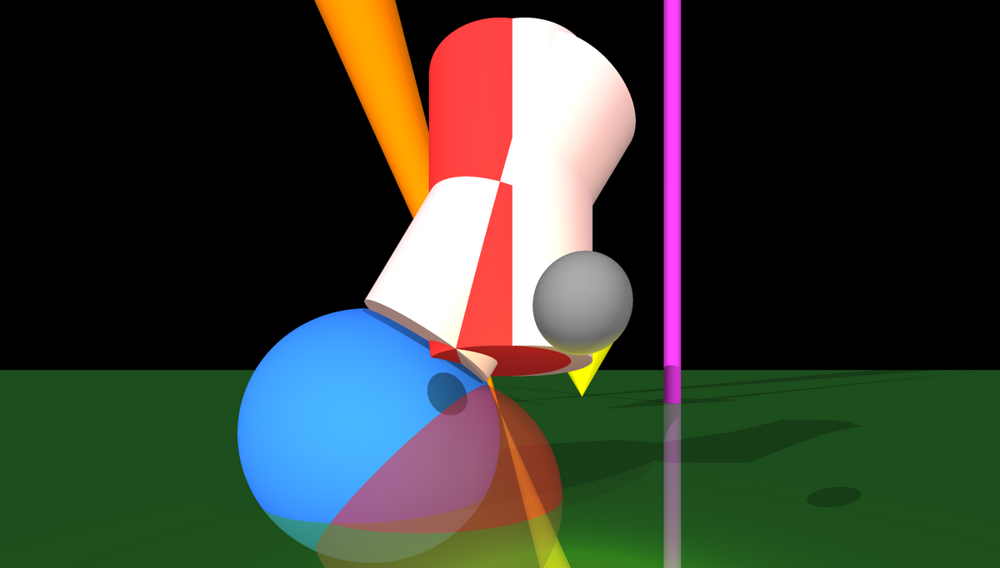

# Raytracer


A ray tracing renderer written from scratch in C++17. It reads a scene description (camera,
shapes, lights) from a configuration file and renders it to an image, with shadows,
transparency, textures and anti-aliasing. Shapes and lights are loaded at runtime as plugins.

Team project, Epitech 2nd year (May 2026).



*`scenes/scene.cfg`, rendered by this program: spheres (one semi-transparent), limited and
infinite cones and cylinders, a plane, point and directional lights with shadows.*

## Features

- **Primitives**: sphere, plane, infinite and limited cylinder, infinite and limited cone,
  triangle, and **OBJ meshes** (with `.mtl` materials, scale, rotation, translation).
- **Lights**: ambient, directional and point lights, with shadow rays and shadows through
  transparent objects.
- **Textures from image files** applied to any shape or group.
- **BVH acceleration** (bounding volume hierarchy over axis-aligned boxes) so that meshes with
  thousands of triangles render in reasonable time.
- **Plugin architecture**: the core is a shared library; shapes and lights are built as separate
  `.so` plugins loaded with `dlopen`.
- **Scene files** in [libconfig](https://hyperrealm.github.io/libconfig/) format, with groups of shapes.
- **Live preview**: the scene file is watched, and editing it re-renders a fast preview
  automatically.
- **Anti-aliasing** with a configurable number of samples.

## My part

I implemented **texture mapping from image files** on every shape type (sphere, plane,
cylinders, cones, triangles, meshes, groups), its parsing in the scene builder and factories,
and its documentation.

## Stack

C++17 · CMake · libconfig++ · `dlopen` plugins · PPM output

## Build and run

Prerequisites: a C++17 compiler, CMake ≥ 3.10 and libconfig++ (`sudo apt install libconfig++-dev`).

```bash
git clone https://github.com/Arthur-piron/raytracer.git
cd raytracer
cmake -S . -B build -DCMAKE_BUILD_TYPE=Release
cmake --build build -j
./raytracer scenes/scene.cfg -a 4      # writes output.ppm, then watches the file for changes
```

| Option | Effect |
|---|---|
| `-a <n>` | anti-aliasing samples |
| `--hardcoded` | render the built-in test scene, no file needed |
| `--help` | usage |

Convert the result to PNG with `convert output.ppm output.png` (ImageMagick).

## Documentation

- [docs/scene-config.md](docs/scene-config.md): scene file format
- [docs/architecture.md](docs/architecture.md): architecture and diagrams
- [docs/core-build.md](docs/core-build.md): how the core library and plugins are built
- [docs/launch.md](docs/launch.md): running the program
